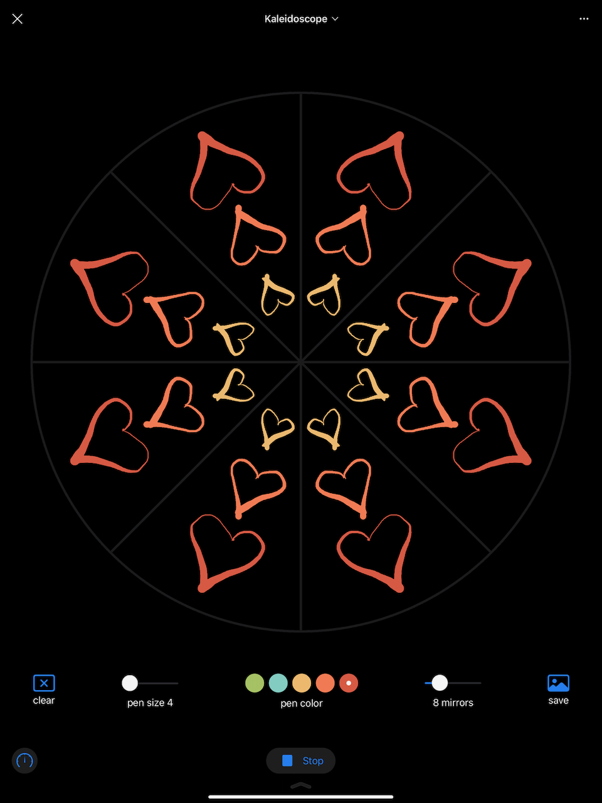

# Kaleidoscope

A drawing kaleidoscope for iPad, Mac and iPhone, written in Swift. I built it in 2020, at age 13, and it was one of the winning submissions to the Apple WWDC20 Swift Student Challenge.

## What it does

The screenshot is from 15 May 2020, two days before I submitted the playground. The label under the right slider said "mirrors" then; it says "segments" now.

You draw with a finger, a mouse or an Apple Pencil inside a circle. Every stroke repeats in each segment of the circle, and every second segment mirrors it, the way the mirrors in a real kaleidoscope do.

- Choose from 2 to 36 segments. The guide lines between segments show at the start and while you change the number of segments, then fade out.
- Set the pen size from 4 to 16 points. With an Apple Pencil, pressure sets the line width.
- Pick one of five colors.
- Clear the canvas, or save the drawing to Photos.

## Gallery

I saved these drawings from the playground in May 2020, while I was building it. I made them with earlier versions, which had other colors than the five in the final code.

| | | |
|---|---|---|
|  |  |  |

## Repository layout

| Path | Content |
|---|---|
| `Kaleidoscope.swiftpm/` | The app playground. Open it in Swift Playground or in Xcode. The code is in `ContentView.swift`. |
| `WWDC20/Kaleidoscope.swift` | The code of the 2020 playground book, extracted from the book without changes. |
| `WWDC20/Kaleidoscope.playgroundbook.zip` | The 2020 playground book, for download. |
| `images/` | Drawings and a screenshot from May 2020, and the cover image of the book. |

The app playground and the 2020 file differ in two places only. The app version has no `import PlaygroundSupport` line, and it has no `PlaygroundPage.current.setLiveView` call at the end, because an app starts from `MyApp.swift`.

## Run the app

| Device | You need | Steps |
|---|---|---|
| Mac | Swift Playground 4.7 or later, macOS 26 or later | Download this repository, open `Kaleidoscope.swiftpm`, and click Run App in the toolbar. |
| iPad | Swift Playground 4.7 or later, iPadOS 26 or later | Copy `Kaleidoscope.swiftpm` to the iPad with AirDrop or iCloud Drive, open it, and tap Run App. |
| iPhone | iOS 26 or later, a Mac with Xcode, a cable, and an Apple Account | Open `Kaleidoscope.swiftpm` in Xcode, choose the iPhone as the run destination, and run. Hold the iPhone in landscape. |

Swift Playground exists for iPad and Mac only, which is why the iPhone needs Xcode. For the iPhone, sign in to your Apple Account in Xcode and select your Personal Team for signing. On the iPhone, turn on Developer Mode in Settings, under Privacy & Security. With a free account the installed app stops working after 7 days, and you then run it from Xcode again.

## Build the app from the source

If you want to build the app yourself from the 2020 code, follow these steps.

1. Open Swift Playground. On a Mac, click Create New App in the welcome window. On an iPad, tap New Playground, then tap App.
2. Open the new app playground, named "My App", and open the file `ContentView.swift`.
3. Replace everything in `ContentView.swift` with the content of `WWDC20/Kaleidoscope.swift`.
4. Delete the line `import PlaygroundSupport` near the top, and delete the last three lines, which call `PlaygroundPage.current.setLiveView`.
5. In App Settings, under Capabilities, add the capability that lets the app add pictures to the photo library, and enter a purpose text such as "Save your drawing to Photos". Without it, the app stops when you tap save.
6. Run the app with the Run App button.

## Run the 2020 playground book

1. Download `WWDC20/Kaleidoscope.playgroundbook.zip` and unzip it.
2. Open the book in Swift Playground.
3. Click the Run Options button at the bottom left of the live view. Turn off Enable Results and turn off Show Console.
4. Choose Run My Code.

Step 3 matters. With Enable Results on, Swift Playground records a result for every line that runs, and the menu itself says that it "may reduce performance". The kaleidoscope runs its drawing code on every touch movement, so with results on, the lines lag behind the pointer. The app playground has no such option.

## How it works

All the code is in one file of about 400 lines.

- The controls are SwiftUI views. The canvas is a UIKit `UIControl`, connected to SwiftUI through `UIViewRepresentable` and a coordinator.
- For each touch movement, the canvas converts the previous and the current point to polar coordinates around the center. It then draws the same line once per segment, rotated by the segment angle. In odd segments it reflects the angle, which produces the mirror effect.
- The drawing is kept as a `UIImage`. On every touch movement the canvas renders it again with `UIGraphicsImageRenderer` and adds the new lines.

## Plans

These are plans, not finished work.

- **iPhone in portrait.** The row of controls is wider than an iPhone screen in portrait. I plan to split the controls into two rows on narrow screens.
- **Apple Watch.** App playgrounds do not support watchOS, so the watch version needs an Xcode project. The canvas uses UIKit classes that watchOS does not have (`UIControl`, `UITouch`, `UIGraphicsImageRenderer`). I plan to rewrite the canvas with the SwiftUI `Canvas` view and `DragGesture`, and to set the number of segments with the Digital Crown.
- **Apple TV.** A TV has no touch screen, and SwiftUI has no `DragGesture` on tvOS. I plan to draw with the touch surface of the Siri Remote through the Game Controller framework, and to add a mode in which the kaleidoscope draws by itself.

## Credits

- The `ImageSaver` class that saves a drawing to Photos comes from [Hacking with Swift](https://www.hackingwithswift.com).
- The coordinator that connects the UIKit canvas to SwiftUI follows a Ray Wenderlich tutorial on drawing in iOS with SwiftUI.
